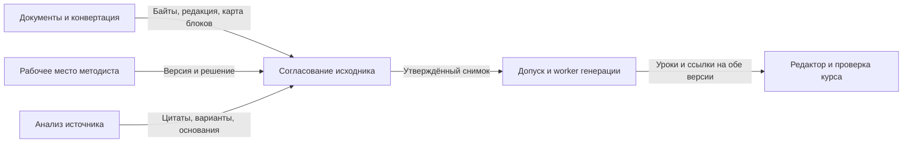

# Согласование рабочей редакции исходника · V1

Статус — реализация подготовлена к приёмке DEV; production зависит от её результата. Владелец Kamilya LMS поручил реализацию и условный выпуск 6 ноября 2026. Владелец интеграции и модуля — Codex в текущем чате; независимый статический обзор API, RLS и worker выполнен агентом Terra 6.1. Статический обзор не заменяет браузерную и смысловую приёмку.

Поставка 0.11.74 включает экран методиста, фоновый анализ текста, сохранение решений и автоматических правок, фиксацию редакции в задании, просмотр сохранённого оригинала и старых утверждений. Непроверенные выделения показываются отдельно и требуют явного решения. Ссылки из редактора курса открывают точную закреплённую редакцию. Извлечение вложенных изображений и подсветка ссылки непосредственно в ученическом уроке остаются отдельными шагами.

## Результат для методиста

Методист загружает документ, получает перечень содержательных вопросов и журнал безопасных исправлений, сверяет выделенные фрагменты, сохраняет решения и утверждает рабочую редакцию. Генерация уроков и тестов запускается только по утверждённой версии выбранных документов. По цитате в курсе можно открыть рабочий фрагмент, соответствующее место оригинала и решение, которое изменило смысл.

[Интерактивный макет](prototype.html) показывает экран проверки, карточки решений, отмену автоправки, журнал и переход к утверждению на синтетическом примере. Для проверки из корня репозитория используется `node --test docs/product/contract-modules/source-editorial-review/prototype.test.cjs`. Chromium открывает отдельную копию файла с отключённой сетью.

## Что уже есть

- `Document` хранит `source_family_id`, `version`, `content_sha256` и отдельный `index_revision`. Хэш файла и редакция индекса описывают разные вещи. Повторная индексация сама по себе не считается изменением смысла. [Модель документа](../../../../apps/api/app/models/document.py)
- `admit_reference_decisions` фиксирует автора на сервере. `reference_context_for_rules` сверяет редакцию, хэш распознанного текста и обе точные цитаты. Сегодня эта трактовка передаётся в задание генерации как контекст. Проектируемое решение хранит её вместе с рабочей редакцией до создания задания. [Контракт отсылок](../../../../apps/api/app/modules/ai/v3/source_reference_decisions.py)
- `submit_course_generation` обслуживает обычную генерацию и подтверждение плана в рабочем месте методиста. CodeGraph подтвердил оба входа, а исходники подтвердили общий вызов. Это точка подключения допуска по утверждённому источнику. Для остальных способов создания курсов проводится отдельная инвентаризация вызовов перед включением проверки. [Допуск генерации](../../../../apps/api/app/modules/ai/router.py) · [Рабочее место](../../../../apps/api/app/modules/methodologist_workbench/document_service.py)
- `require_current_draft_review` уже вызывается при одобрении и публикации курса и при решении назначенного рецензента. Этот контроль сверяет готовый курс с источником и сохраняется как отдельная проверка. [Проверка черновика курса](../../../../apps/api/app/modules/courses/source_uncertainty.py)

## 1. Как различаем правки и вопросы

| Класс | Условие | Решение в V1 |
| --- | --- | --- |
| Редакторская правка | Одно восстановление с проверяемым основанием. Сохраняются смысл, структура и границы правила | Применить в рабочем тексте и записать до/после. Методист может отменить |
| Однозначная связь | Полная цитата из того же источника однозначно закрывает вопрос, включая нужные условия и исключения | Сохранить обе цитаты и объяснение. Если буквальный текст меняется, обработать изменение по классу риска |
| Требуется решение | Возможны разные действия, исполнители или границы. Не хватает данных для надёжного выбора | Показать вопрос, оригинал, связанные фрагменты, варианты и последствия. До решения заблокировать утверждение |
| Проблема извлечения | Отсутствует лист, разорвана таблица, потеряна строка либо ссылка на недоступный визуальный материал | Попросить повторно извлечь, загрузить читаемый источник или восстановить точный фрагмент с указанием основания. После восстановления перепроверить затронутые связи |
| Наблюдение | Стиль, повтор или оформление, которые допускают текущую редакцию и не меняют обучение | Показать отдельно, без обязательного решения |

Суммы, сроки, отрицания, модальность, условия, исключения, ответственность, ссылки, порядок шагов и принадлежность строк таблицы защищены от автоматического смыслового изменения. Уверенность модели помогает сортировке, но право автоправки определяет проверяемое основание. Перенос строки внутри слова можно убрать, если связь однозначна. Нумерацию пунктов и строк сначала проверяют вместе с отсылками, затем меняют только в согласованной редакции.

Сначала извлечение выделяет разделы, таблицы и точные адреса фрагментов. Анализ получает смысловой блок вместе с условиями, исключениями и связанными пунктами. Один вопрос с несколькими проявлениями объединяется в карточку со всеми местами. Сохранение решения повторно проверяет только изменённый блок и связанные с ним условия. Если после изменения смысл нельзя подтвердить, карточка вновь открывается. При чистом результате методист получает короткую сводку и утверждает редакцию одним действием.

«В учётной каротчке» → «в учётной карточке» проходит как опечатка. «Расходных сопротивлений» требует вопроса, пока соседние положения или согласованный словарь не дают единственного подтверждённого термина. При неоднозначной ссылке «по п. 2» карточка показывает оба возможных пункта и что изменится при каждом выборе. Выбор владельца для конкретной версии «стандарты26» применяется только к этой версии и этому месту. Граница «до 45» рядом со «свыше 45» требует явной записи о значении ровно 45. Внешний норматив может быть приложен как основание, а внутреннее правило утверждает уполномоченный человек.

## 2. Путь и экран

1. **Документы → Проверить исходник.** После извлечения показываем состояние распознавания. Запуск проверки источника создаёт отдельное задание с видимым статусом. Готовые результаты сохраняются при выходе со страницы. Переход из «Создать курс из материалов» открывает ту же проверку.
2. **Вопросы к источнику.** Слева список с причинами и счётчиком незакрытых вопросов. Справа вопрос, исходная цитата с местом, контекст и варианты с последствиями. На телефоне список и детали идут друг за другом, а переход к деталям сохраняет фокус. Для длинного документа рядом с цитатой есть переход к контексту и поиск по разделам.
3. **Решение.** Выбрать вариант, ввести собственную формулировку или оставить вопрос открытым для уточнения. Ввести основание. «Помощь ИИ» получает только вопрос и связанные фрагменты, возвращает редактируемое предложение и показывает использованные цитаты. Сохранение выполняет человек. Если предложение ошибочно, методист может оставить оригинал с обоснованием, когда это действительно снимает двусмысленность. Отказ от варианта при сохраняющейся неоднозначности оставляет блокировку.
4. **Автоправки и журнал.** Сводка с раскрываемыми «до / после», автором, временем и основанием. Отмена создаёт обратное событие. Если фрагмент успели изменить, требуется явная сверка. История сохраняет прежнее решение и связь с новой редакцией.
5. **Утвердить рабочую редакцию.** Сервер проверяет текущую версию, открытые блокировки, извлечение и воспроизводимость текста. После утверждения показываем номер версии, кто её утвердил, и кнопку «Перейти к генерации». Для последующей правки создаём новый черновик редакции. Утверждённый снимок остаётся доступен по старой ссылке.

Для V1 выбран строгий допуск. Существенный открытый вопрос останавливает генерацию из выбранного документа. Пользователь может выбрать другой, независимо утверждённый источник. Частичное исключение спорных фрагментов потребует отдельного интерфейса с подтверждением потери покрытия.

## 3. Модули и интерфейсы

| Владелец | Данные и интерфейс | Влияние |
| --- | --- | --- |
| Документы | Оригинальные байты, семейство, ревизия, карта извлечённых блоков | Используем действующую идентичность. Рабочая редакция появляется как отдельный утверждаемый снимок того же источника |
| Согласование исходника | Черновая редакция, вопросы, решения, события и утверждённые снимки | Один модуль проверяет версии, права, пересечения правок и блокировки |
| Анализ источника | Предложения с цитатами и затронутыми связями | Выделяет изменения смысла. Право утверждения находится у человека |
| Допуск и worker генерации | Закреплённый набор снимков и версии проверок | Сервер проверяет каждый выбранный источник до резервирования AI-квоты и создания задания. Worker сверяет сохранённые хэши перед обращением к модели |
| Проверка курса | Сохранённые уроки, тесты, цитаты и решения по курсу | Прежний контроль результата получает ссылки на исходник и редакцию, по которой создан курс |

Интерфейс модуля. Прочитать проверку с текущим номером редакции, записать решение по конкретному вопросу, отменить автоправку, утвердить редакцию, получить проверенный снимок для генерации. Анализ возвращает список предложений, связанных с точным текстом и картой фрагментов. UI показывает эти данные и отправляет команды. Все переходы состояния и повторные проверки выполняет сервер.

### Идентичность и журнал

- Снимок включает идентификатор документа, хэш байтов оригинала, хэш распознанного текста, версию конвертера и схему адресации, идентификатор и хэш рабочего текста. Редакция индекса хранится отдельно.
- Место указывается устойчивым ID блока внутри ревизии и диапазоном символов с точной цитатой. Для PDF добавляется страница, для таблицы — строка, колонка и заголовок. При повторном извлечении совпадение заголовка или номера пункта само по себе не переносит решение на новый текст.
- Событие журнала содержит ID, tenant, автора и тип автора, время сервера, вопрос или правку, место, «до / после», основание, выбранное решение, предыдущую и следующую версии. Для автоизменения сохраняются правило и версия анализатора. Для подсказки ИИ различаются предложившая модель и утвердивший человек.
- При изменении связанного блока сервер помечает затронутые решения на перепроверку. Непересекающиеся решения остаются в черновике. Утверждение делает снимок неизменяемым и сохраняет карту «рабочий фрагмент → оригинал и событие». Конвертация изображения входит в отдельный backlog. Если значимый визуальный блок потерян, статус извлечения блокирует утверждение.

### Конкуренция, сбой и доступ

- Запись решения и утверждение требуют ожидаемую ревизию черновика и ключ идемпотентности. Два изменения с одним ожидаемым номером не затирают друг друга. Ответ о конфликте возвращает номер актуальной версии, а UI сохраняет несохранённый ввод для сравнения. Повтор с тем же ключом и телом возвращает первое подтверждённое решение.
- Запись рабочего текста, события и нового номера идёт в одной транзакции. После неизвестного исхода клиент перечитывает журнал. После сбоя анализа повторяется только невыполненный этап, результаты предыдущего разбора сохраняются. Сбой анализа и отсутствие проверяемой привязки остаются явными состояниями.
- Сервер проверяет tenant, принадлежность документа и активную роль на чтении, правках, утверждении и допуске. В рамках текущей ролевой модели проверяет активный методист с доступом к документу. Если для ответа нужен внешний владелец регламента, методист вносит ответ и основание. Полномочия подтверждения фиксируются сервером. Для новых таблиц нужны RLS, FORCE RLS и проверки на runtime-роли без BYPASSRLS.
- При допуске набора документов снимки закрепляются в том же контуре, что и запись задания. Если источник обновили после допуска, запущенная задача продолжает работу по уже закреплённой версии. При отсутствии закреплённого снимка worker останавливается до вызова модели. Следующий запуск требует актуального утверждения. Опубликованные курсы и их история хранят прежние ссылки.

## 4. Приёмка

| Сценарий | Доказательство |
| --- | --- |
| Однозначная опечатка и спорный срок в одном документе | Опечатка есть в журнале. Неуточнённый срок удерживает редакцию. Отклонение предложенного значения срок не закрывает |
| Отсылка, граница и термин | Методист видит точные цитаты и последствия, принимает один вариант, вводит ручной ответ и оставляет третий вопрос открытым. UI и прямой API дают одинаковый допуск |
| Повтор и конкурентная правка | Повтор возвращает исходный результат. При двух изменениях сохраняется подтверждённое решение, второй редактор видит конфликт и свой текст. В истории нет двойного события |
| Переиндексация, замена и сбой | Та же ревизия без изменений текста остаётся связанной. Новая конвертация с изменённым фрагментом требует проверки. После сбоя утверждённый снимок, журнал и незакрытые вопросы восстанавливаются |
| Изоляция | Другой tenant получает 404 при чтении, записи и попытке подставить снимок. Неуполномоченная роль не принимает решения. Подмена цитаты и версии блокируется сервером |
| Полный путь | До утверждения нет записи задания, резервирования AI-квоты и обращения к модели генерации. После утверждения генерируется курс по утверждённому хэшу. Цитата из урока открывает рабочий текст, исходник и историю правки |
| Интерфейс | Проверить список, ввод, черновик, журнал, конфликт, повторное открытие и клавиатуру на ширинах 390 и 1440 px. Измерить время до первого решения, число вопросов, которые методист счёл лишними, и расход отдельных запросов анализа |

Порядок реализации: детерминированные контракты снимка и решений, анализ, интерфейс и серверный допуск. Ранее допущенные задания продолжают исходный путь. Для новых запусков, включая прежние документы, нужна утверждённая редакция. Если выключить `SOURCE_EDITORIAL_REVIEW_ENABLED`, новые задания смогут стартовать по прежнему контракту, а уже закреплённые редакции и журнал останутся доступны. При откате приложения таблица 0185 сохраняется.
